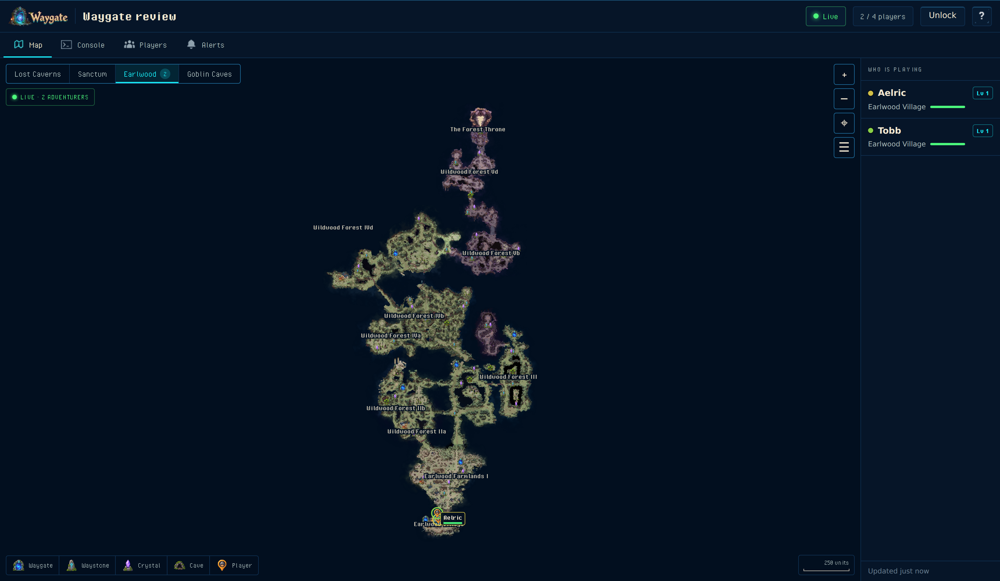
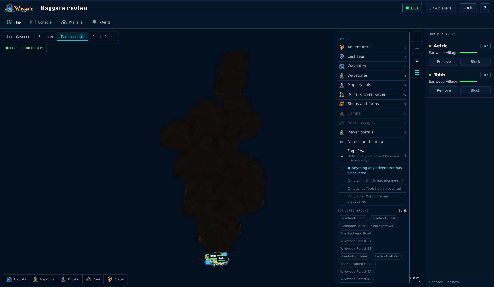
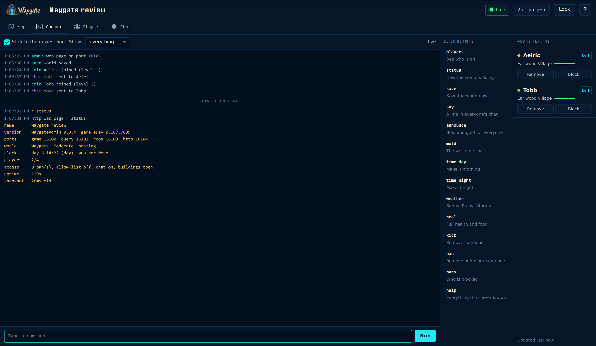

<p align="center">
  
</p>

<p align="center">
  <a href="#requirements"></a>
  <a href="https://store.steampowered.com/app/2402680/"></a>
  <a href="https://github.com/HumanGenome/Waygate"></a>
  <a href="LICENSE"></a>
</p>

# WaygateServer

[Dimraeth](https://store.steampowered.com/app/2402680/) has no dedicated server. Its multiplayer is a Steam lobby hosted from one player's copy of the game. WaygateServer adds a Dimraeth dedicated server you run on a Windows PC. Players join it by IP with the [Waygate app](https://github.com/HumanGenome/Waygate).

## What it does

- Runs Dimraeth with no screen, no desktop session and no Steam login
- Leaves a world alone when this game version can't read it, and says why in the boot report. The game on its own moves that world aside and starts a new one
- Tells a player in the app, before they connect, when their game version doesn't match the server's. The game on its own just drops them
- Join by IP: players connect straight to its IP and port
- Has no character of its own, so it doesn't count toward the player limit, lead the party or show up in the player list
- Live map: its own web page shows the world drawn from the game's own pixels, every player's position every five seconds and fog of war over ground nobody has found yet, plus the console, who's playing and Discord alerts
- Runs server mods, and tells the Waygate app which mods players need on their PC, so they get them when they connect
- Source RCON and a signed HTTP API for admin tools, once an admin password is set
- World backups: the Waygate app's World window lists them, downloads or restores one, and uploads a save from a zip. The running world is backed up first, and a world this game version can't load is turned away before anything changes
- A stopped server still has a map: a copy of the map as it was at the last save, written when the world is saved, when the server stops cleanly, and at most once a minute while people play (`waygate/map-last.json`)
- An activity list: who joined, left, died and what killed them, levelled up, beat a boss or was turned away, and when the server started and stopped. Names and character ids only, never chat or addresses, and never more than 2 MB (`waygate/events.jsonl`). Server tools read it with `GET /api/v1/events`
- `GET /api/v1/players/known` lists every character this world has seen and where each was last
- Ban and whitelist players by character and address. Both last through restarts
- Shows up in server lists: answers Source server queries on the port above the game port
- Password protection
- Up to 8 players, the game's own limit

## Known limitations

- **It isn't an anti-cheat.** Waygate doesn't check what players do in the game.

## Requirements

| | |
|---|---|
| OS | Windows 10, Windows 11, or Windows Server |
| Game files | A Dimraeth installation on the host, from your own Steam copy (about 4.6 GB) |
| Ports | Two UDP ports: the game port and the one above it for server query. Three TCP ports above those for RCON, the admin API and the web page, opened only for the people who should reach them |
| Hardware | No graphics card needed. Plan on 4 to 8 GB of RAM per server: the game runs the whole world even with nobody online |

## Ports

| Port | Protocol | Used for |
|---|---|---|
| base (default `15569`) | UDP | Gameplay, the port players connect to |
| base + 1 (default `15570`) | UDP | Server query (Source A2S) |
| base + 3 (default `15572`) | TCP | Source RCON, once an admin password is set |
| base + 4 (default `15573`) | TCP | The admin API the Waygate app's Console tab uses, once an admin password is set |
| base + 5 (default `15574`) | TCP | The server's own web page: live map, console, players, alerts ([docs/web.md](docs/web.md)) |

The two UDP ports must be open on the host firewall and forwarded if the server sits behind NAT. Open the TCP ports only for the people who should reach them. If another program already uses the query, RCON, admin API or web port, Waygate picks a spare one in the same block of ten and says so ([docs/status-and-commands.md](docs/status-and-commands.md#when-a-port-is-taken)).

## Setup

1. Put a copy of Dimraeth's game files on the host (install it through Steam on any PC and copy the game folder, or use SteamCMD with an account that owns the game).
2. Download `WaygateServer-<version>.zip` from the [latest release](https://github.com/HumanGenome/WaygateServer/releases/latest) and unzip it **over** the game folder, so `winhttp.dll` and `BepInEx\` sit beside `Dimraeth.exe`.
3. Edit `BepInEx\config\com.humangenome.waygate.host.cfg`: set the gameplay port, the server name, the world name and difficulty, and a join password if you want one.
4. Start the server from the game folder:

   ```
   Dimraeth.exe -batchmode -nographics
   ```

   The world is created on the first start. `waygate\boot-report.txt` says `HOSTING` once players can join, or exactly what stopped it if they can't.
5. Give players the IP and port as `ip:port`. They click Add server in the Waygate app, type it in and click Connect.

Running two servers on one machine: each needs its own gameplay port and its own `--waygate-dir=<folder>`, so their saves and status files never share a path. Give each its own copy of the game folder, or run both from one folder and point each at its own host config with `--waygate-config=<path to its .cfg>`; the admin settings are then read from `com.humangenome.waygate.admin.cfg` in the same folder as that file. Two servers started from one folder without it read the same config and ask for the same port.

## The web page

Open `http://<server ip>:<game port + 5>/` in a browser. The server runs the page itself, so there's nothing else to install, and it works with no internet.

<p align="center">
  
</p>

- **Map**: the world from the game's own pixels, one tab per area, sharp all the way in to the game's closest zoom. Every connected player's position and name, refreshed every five seconds; the Waygates and map crystals they have found; boss fights, portals and the Sanctum's buildings. The layers menu picks what is drawn, and its fog of war hides every region no player has discovered yet, the game's own fog, either for anyone's discoveries or one player's.
- **Console**: the server's live log and a command line, with the common commands one click away.
- **Players**: everyone connected, with level, area and time on. Kick or ban a player.
- **Alerts**: Discord messages the server posts itself for joins and leaves, deaths, a full server, the world coming up and a scheduled stop.

<p align="center">
  
</p>

<p align="center">
  
</p>

Anyone with the address sees the map and who is playing. The console, kick and ban, and the alerts unlock with the admin password (`Password` under `[Admin]` in `BepInEx\config\com.humangenome.waygate.admin.cfg`), the same one RCON and the Waygate app's Console tab use. It stays in the browser it was typed in and signs each action instead of being sent. `PublicMap = false` under `[Web]` puts the map behind the password too, and `Enable = false` switches the page off. The page can't tell you the server is down, because a stopped server sends nothing. Settings, sharing and what it can't do are in [docs/web.md](docs/web.md).

## Running it from a panel or a script

`waygate\status.json` is rewritten every 5 seconds with the verdict, ports, player count, roster and uptime. Drop a `waygate\commands.txt` with `save`, `shutdown`, `restart` or `kick <name>` and the server runs it within 2 seconds. Details: [docs/status-and-commands.md](docs/status-and-commands.md).

## Rent a server

[SurvivalServers.com](https://www.survivalservers.com/services/game_servers/dimraeth/?utm_source=github&utm_medium=readme_install&utm_campaign=waygate) runs Dimraeth servers with WaygateServer installed.

## Changelog

Every released version is listed in [CHANGELOG.md](CHANGELOG.md), split by what changed on the **Server** and what changed on the **Client**. Release pages quote the matching section verbatim.

## Contributing

Bugs: [open an issue](https://github.com/HumanGenome/WaygateServer/issues).

See [CONTRIBUTING.md](CONTRIBUTING.md). Security issues go through [private reporting](.github/SECURITY.md), never a public issue.

## Community note

Waygate is an independent community project. It is not affiliated with, endorsed by, or supported by Mudtek.

## License

MIT, see [LICENSE](LICENSE).
